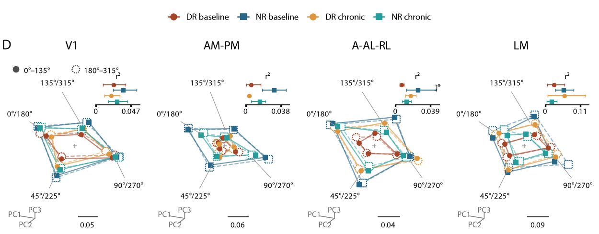
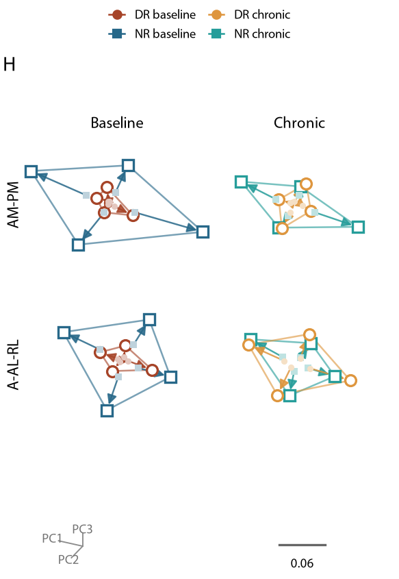

# Visual experience shapes population representations

Core analyses for **Leveltlab/visual-experience-population**: population geometry, linear decoding, and shared PCA views of visual cortical responses.

[Preprint · bioRxiv](https://doi.org/10.1101/2024.08.31.610645) · [Figure notebook](plotting/figures.ipynb) · [Protocol](protocol.json)

The preprint is expected to be updated with these results. This local repository is an unpublished preparation for that update.

## Population geometry at a glance

**D · Direction geometry in a shared PCA frame**



Eight directions remain distinct through alignment and PCA. Filled and dashed-outline markers identify opposite directions. Each area's scale bar records its display magnification; the insets quantify radius in the full ten-neuron space.

**H · Contrast-dependent geometry**



Low- and high-contrast centroids share one camera, coordinate system, and scale. Arrows connect corresponding orientation centers. Both PCA views are descriptive summaries of aligned group means, not independent statistical tests.

## Export the panels

```sh
uv sync --locked
uv run jupyter lab plotting/figures.ipynb
```

Run the notebook from top to bottom. It reads a **approximately 0.5 MB frozen plotting snapshot**, verifies its SHA-256 hashes, and exports individual **SVG, outlined SVG, PDF, and PNG** panels to `plotting/exports/`. No recordings, refitting, R installation, or connection to jaxneuro are needed for this path. Myriad Pro Regular is required for the accepted typography; install a licensed copy locally or pass its directory to `plotting.style.use_myriad_pro`. Fonts are not redistributed.

The single notebook contains B, C, D, F, G, H, the full angular profile supporting B, the Euclidean-distance B supplement, and same-direction cross-contrast cosine. It also exposes the PCA/radius audit tables. Change its `RESULTS` setting to export a newly computed run instead of the frozen snapshot, then restart the kernel.

## Small, analysis-first layout

| Folder | Contents |
| --- | --- |
| `preprocess/` | MATLAB conversion, signal loading, registered session inventory, raw response preparation, fixed folds |
| `geometry/` | B cosine and Euclidean geometry, D radius inset, F peak radius, mouse-level inference |
| `decoding/` | Ledoit–Wolf LDA; high-contrast orientation/direction decoding (C), full four-bin transfer matrices (G) |
| `dimensionality-reduction/` | Training-only within-area alignment and descriptive shared PCA for D/H |
| `plotting/` | Panel renderers, one final notebook, compact source data and D/H previews |
| `tests/` | Geometry invariants, pooling/peak order, held-out isolation, PCA registration and LDA reference checks |

The hyphenated PCA folder is installed as the Python package `dimensionality_reduction`. `analysis_config.py` holds paths and the common mouse-bootstrap helpers; `run.py` runs only the retained figure families.

## Recompute from recordings

The numerical protocol is inherited from the active jaxneuro flagship analysis, with no baseline subtraction, variance normalization, extra scaling, or smoothing:

- Raw **deconvolved activity** by default; **10 neurons**, **1,000 shared draws**, and **five fixed stratified folds** per session–area population.
- Time-averaged responses use **0 ≤ t < 0.5 s**. F takes the peak over native frames in **0 ≤ t ≤ 0.5 s**, after averaging draws and sessions within mouse.
- Sessions are averaged within mouse; mice receive equal weight. Intervals use 5,000 shared mouse-bootstrap resamples. Draws and folds are technical repeats.
- LDA uses analytic Ledoit–Wolf shrinkage of pooled **training residuals**, with class-frequency priors. This is not sklearn LDA's classwise `shrinkage="auto"`.
- B/C/D pool the **top two contrasts**. F compares **bottom two versus top two**. G uses four adjacent pairs and displays **4→3, 3→2, 2→1**. H pools **bottom four versus top four**, preserving eight direction labels until after PCA.
- Within-area alignment uses training centroids and rotates held-out centroids without scaling. Subsequent cross-area registration and PCA use group means and are descriptive. Ordinary cosine, distance and radius estimates retain finite-trial noise; F also includes peak-selection bias.

The registered source dataset contains 73 prepared sessions; 116 session–area populations from 72 contributing sessions and 27 mice enter the figures. The session registry preserves identity/order so that preparation regenerates the same folds and neuron selections. It is not a generic ingestion scheme for unrelated experiments.

```sh
# Existing pooled NumPy inputs, or first convert the original MATLAB hierarchy:
uv run python -m preprocess.matlab2py --input /path/to/gratingWarped --output /path/to/pydata

export VEP_PYDATA_DIR=/path/to/pydata
uv run python run.py --stage prepare
uv run python run.py --stage geometry
uv run python run.py --stage decoding
uv run python run.py --stage pca

# Requires R with nparLD exactly 2.3.3 and its dependencies:
uv run python run.py --stage statistics
uv run python run.py --stage supplement
```

`uv run python run.py` runs those stages in order. CPU JAX is selected by the runner. LDA checkpoints are reused only when input and code hashes match. Other families rebuild their small summaries. A completed plotting snapshot is not evidence that a new raw-data run has completed.

Accepted inference uses nparLD 2.3.3 ANOVA-type statistics with the crossed rearing × area × time × panel-specific-factor design, incomplete records retained, and within-panel Holm correction across four main effects. C uses chance-normalized accuracy; F uses log radius. Exact two-sided NR–DR rank-sum comparisons retain the registered endpoints and correction families. See [the statistical caption](plotting/source_data/manuscript_statistics/captions.txt) for the full definitions and limitations. Use `R_LIBS_USER` for a nonstandard R library location; the scripts fail on a different nparLD version.

### Inputs and outputs

| Setting | Default | Purpose |
| --- | --- | --- |
| `VEP_SIGNAL` | `spikes` | Raw deconvolved input; set `calcium` to reuse the same pipeline on raw calcium |
| `VEP_PYDATA_DIR` | `preprocess/pydata` | Materialized recordings with a `pooled/` subfolder |
| `VEP_DATA_DIR` | `data/<signal>` | Prepared responses, temporal arrays, neuron selections, and folds |
| `VEP_RESULTS_DIR` | `results/<signal>` | Computed results; the notebook explicitly selects its frozen snapshot by default |

Set variables **before importing modules**. Calcium is an optional input path using the same raw-signal protocol, not a claim to reproduce historical normalized calcium analyses. No calcium results are included or generated here. Recordings, prepared arrays, fit caches and exports are ignored by Git. The snapshot is only sufficient to redraw the selected panels; it is not the full original-input/draw-level data deposit.

## Validation and provenance

```sh
uv run pytest -q
```

[Provenance](provenance.json) records the extracted source hashes. [Snapshot manifest](plotting/source_data/manifest.json) hashes the bundled numerical inputs. [Validation](VALIDATION.md) distinguishes checked exports and numerical parity from a complete raw-data rerun. The source jaxneuro checkout and its hosted viewer are unchanged.
